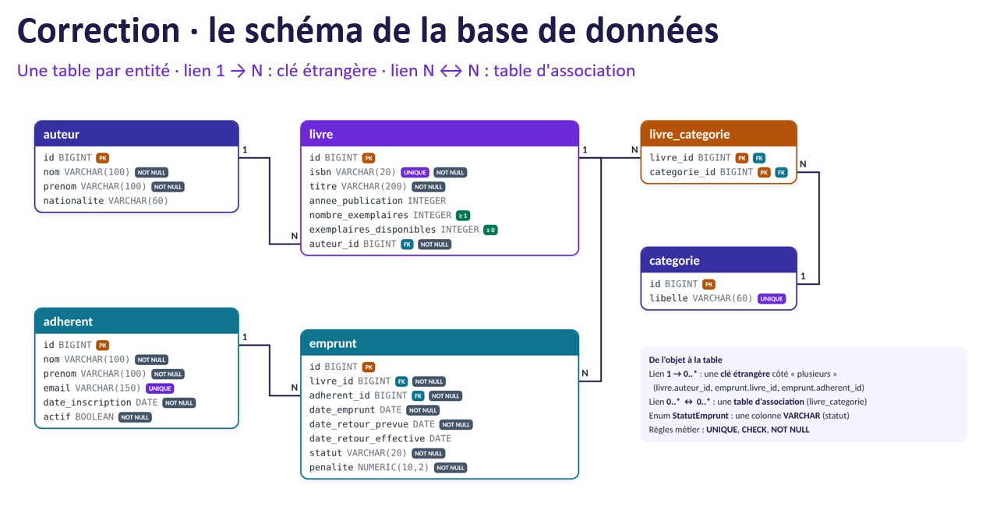

# java_api_rest

Liste des 22 Endpoints à partir de ce schéma de base de données: 

Methode -   URL               - Succes   -  Erreurs
----------------------------------------------------

22 endpoints :

POST -  /api/v1../adherents    - 201  -   credentials
GET -   /api/v1../adherents   - 200  -   400
(GET -   /api/v1../adherents/:id   - 200  -   400)
PUT / PATCH -  /api/v1../adherents/:id    - 500  -   credentials
DELETE -  /api/v1../adherents/:id    - 20e1  -   credentials

POST -  /api/v1../livres    - 201  -   credentials
GET -   /api/v1../livres   - 200  -   400
GET -   /api/v1../livres/:id   - 200  -   400
PUT / PATCH -  /api/v1../livres/:id    - 500  -   credentials
DELETE -  /api/v1../livres/:id    - 201  -   credentials

POST -  /api/v1../auteurs    - 201  -   credentials
GET -   /api/v1../auteurs   - 200  -   400
GET -   /api/v1../auteurs/:id   - 200  -   400
PUT / PATCH -  /api/v1../auteurs/:id    - 500  -   credentials
DELETE -  /api/v1../auteurs/:id    - 20e1  -   credentials

POST -  /api/v1../emprunts    - 201  -   credentials
GET -   /api/v1../emprunts   - 200  -   400
GET -   /api/v1../emprunts/:id   - 200  -   400
PUT / PATCH -  /api/v1../emprunts/:id    - 500  -   credentials

POST -  /api/v1../categories    - 201  -   credentials
GET -   /api/v1../categories   - 200  -   400
GET -   /api/v1../categories/:id   - 200  -   400
PUT / PATCH -  /api/v1../categories/:id    - 500  -   credentials
DELETE -  /api/v1../categories/:id    - 20e1  -   credentials

POST -  /api/v1../livre_categories    - 201  -   credentials
GET -   /api/v1../livre_categories   - 200  -   400
PUT / PATCH -  /api/v1../livre_categories/:id    - 500  -  credentials

